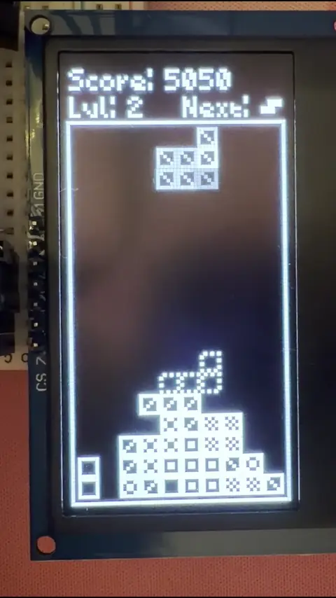
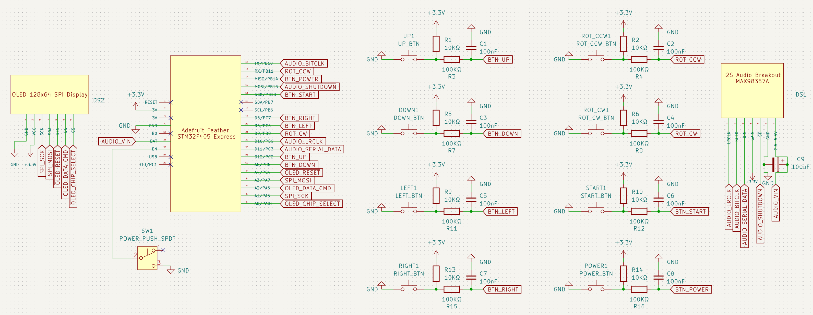
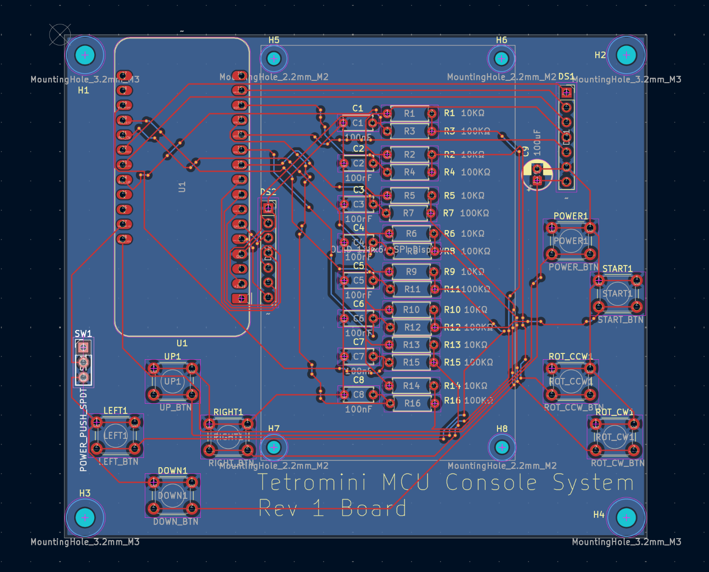
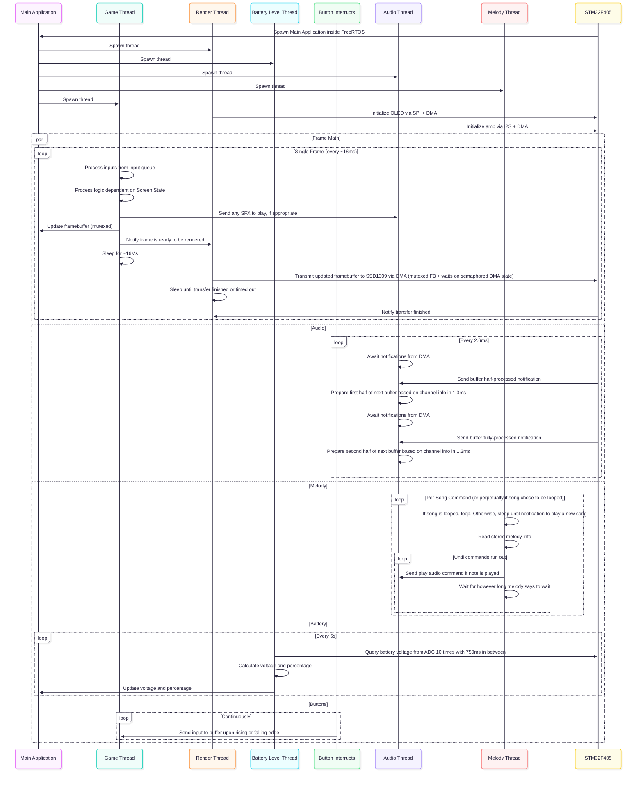
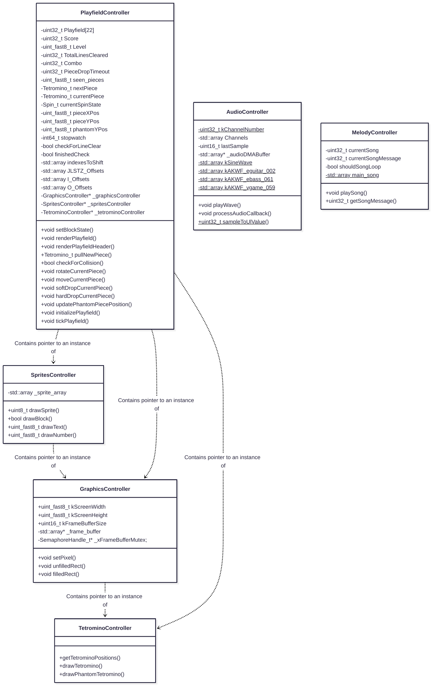

# Tetromini - STM Edition (In active development)

This is a refactor of the old Nordic/Zephyr version of the project for the STM32F405/freeRTOS pipeline that is archived in `dev`!

## About
Tetromini is a portable console based on an Adafruit Feather STM32F405 Express running a custom firmware inside freeRTOS that plays a fan-made version of a falling-block puzzle game!

The project consists of multiple parts. As of writing, the firmware that controls the console itself and the game inside the firmware have a working version!

Future developments may want to explore things such as:
- [ ] Game over screens
- [ ] High score tracking
- [ ] A custom PCB Hat for the Feather
- [ ] A custom enclosure shaped like a T-Block Tetromino

## Features
- Sprite-based rendering
- 4 directional inputs (move left, move right, soft drop, hard drop)
- Clockwise and counterclockwise rotation
- Dynamic gravity and boosted score based on level
- Combo points per consecutive line clears
- Pseudorandomly chosen pieces
- Dropped pieces and 4 different line clear sound effects
- Multi-channel soundtrack played via synthesized notes with custom notes system
- Multithreaded parallel execution

## Schematics, PCB and BOM
The below KiCad schematic is based on Rev 1, running on a breadboard, and set to run on a milled-PCB. (last updated Oct 27th 2026)

Bill Of Materials for Rev 1 (last updated Oct 27th 2026):
| Reference                                                       | Description                             | MPN      | DigiKey_PN                 | Manufacturer |
|-----------------------------------------------------------------|-----------------------------------------|----------|----------------------------|--------------|
| U1                                                              | Feather STM32F405 Express               | 4382     | 1528-4382-ND               | Adafruit     |
| DS1                                                             | Generic 2.42in SSD1309 OLED SPI Display | --       | --                         | HiLetgo      |
| DS2                                                             | I2S Audio Breakout                      | 14809    | 1568-14809-ND              | Sparkfun     |
| DOWN1,LEFT1,RIGHT1,ROT_LEFT1,ROT_RIGHT1,UP1,START_BTN,POWER_BTN | Push button switch, generic, two pins   | MJTP1234 | 679-2442-ND                | APEM Inc.    |
| C9                                                              | 100UF Capacitor                         | 16ZLH100MEFC5X11 | 1189-1148-ND       | Rubycon      |
| --                                                              | 8ohm 700MW Speaker                      | CMS-181325-078L100B-67 | 2223-CMS-181325-078L100B-67-ND | Same Sky |
| --                                                              | Lithium Battery                         | 258      | 1528-1838-ND               | Adafruit     |
| --                                                              | SMD SWD Header for Feather              | 4048     | 1528-2827-ND               | Adafruit     |

(Resistors, SPDT Slide Switch and 100NF Capacitors are Jellybean parts and weren't purchased through major manufacturers, and therefore aren't reflected in the BOM)

## Firmware and Multithreading

The project's firmware is based on FreeRTOS, and is set up by multiple concurrent threads that run in parallel. Their execution and basic behaviours can be seen below:

## Controllers
Most of the threads' behaviour (specifically the Melody, Audio and Game Threads) are abstracted away inside of **Controller Classes**. This is the overview of what controllers exist inside those threads, and how they interact with each other.

## Sprite Rendering
Given we only have 1MB of flash and 128KB of RAM, the 6x6 px sprites need to take up as little space as possible. Since the OLED display is monochrome, they are stored in binary pixel format.

Given a source bitmap tilemap of all sprites, for each one, a count of their collumns (and therefore their horizontal resolution) is stored, and then each collumn is stored in a byte, with two leftover bits, for a total of 7 bytes per sprite. The actual arrays are programatically calculated and written down via a Python script run at build time.

When rendering sprites, a caret system is used to allow for interchanging and nested text and number rendering by leveraging the column size parameter.

Each sprite, when rendered, is stored in a framebuffer that gets sent via SPI + DMA to the OLED display through a custom SSD1309 driver. Each pixel drawing and render command protects the buffer via a Mutex.

## Melody Playback

Given that a singular second of stored audio would be 96KB given an audio playback of 48kHz and 16-bit amplitude resolution, it is impractical (to put it lightly) to store full scores. As such, given the programmed behaviour of the Audio Task, songs are stored as several "play note" and "sleep" commands calculated from a given MIDI file.

Commands are arranged as follows: a 32-bit word arranged with masks as follows: `0x1F` for note (N), `0xE0` for octave (C), `0xFF00` for length (L), `0x7F0000` for volume (V), `0x7F800000` for waveId (W) for a final word `0b0WWW WWWW WVVV VVVV LLLL LLLL CCCN NNNN`. The most significant bit is restricted to indicate a wait time on stored songs, followed by a 31-bit integer indicating how many milliseconds to sleep before the next command.

This made it such that, for example, the `main_song.mid` file, whose raw uncompressed wave would occupy **3.686MB** for a 38.4s playback, and MIDI file occupies *2.4KB*, takes up around *1.932KB* in RAM!

## Audio Synthesization

To generate the sound waves for the different instruments, the raw amplitudes of a single wave are stored as 600 16-bit integers spread equidistant across the single wavelength, and a "jump" floating point number is calculated based on the wave's desired pitch and the 48kHz playback. This means each instrument takes up around 1.2KB. Upon playback, we use that number to "jump" across amplitudes during playback to simulate pitch shifting. Each wave has an attack and decay envelope to avoid crackling on consecutive playbacks. The audio system can support up to `kChannelNumber` different waves to be played at the same time. A 256-integer-long buffer is then sent via I2S + Circular DMA to the I2S Breakout, and each half is filled based on ISR routines sent by the DMA coroutine.

## "Random" Piece Generation
Since RTOSs are to be deterministic machines, true randomness isn't recommended. However, it is wished that games don't look the same across gameplays. As such, a custom pseudorandom number generation system was created in addition to a traditional "bag system" wherein each of the 7 pieces are pulled from a metaphorical "bag" before being reshuffled when all of them are pulled. This bag system ensures that no same piece is ever pulled more than twice in a row.

As soon as gameplay begins, a salt is initialized and incremented by 26489 every frame, and set to wrap at 2147457158. To further randomize initial conditions, a random number of pieces are pulled out and discarded, and two pieces are chosen at random. Whenever it is time to choose a piece at (seemingly) random, this salt is added to 3739 times the current ticks since boot for an internal random variable, and then the salt is incremented by 14929. By this nature, under extremely precise and calculated circumstances, gameplay COULD be fully deterministic, but under normal gameplay, it is seemingly random.

## Debugging
Debugging is achieved live on the board using a Segger J-Link EDU! This project is purely for learning's sake, so yay!

## Disclaimer
Tetris® is a registered trademark of The Tetris Company, LLC. This project is not affiliated with or endorsed by The Tetris Company.